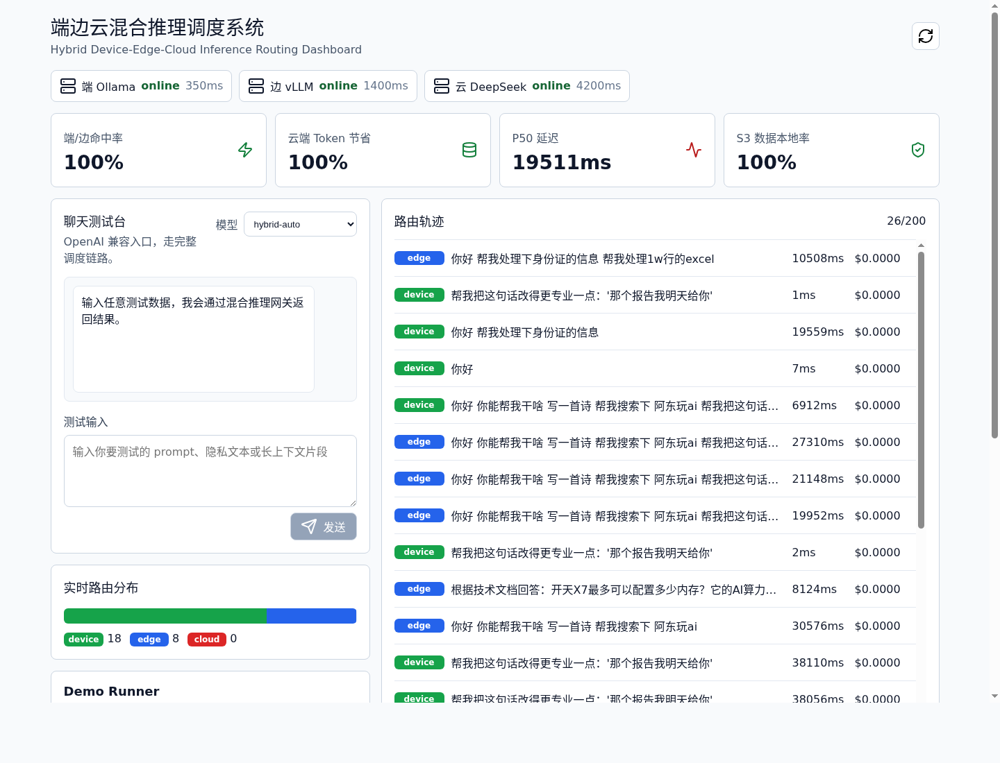
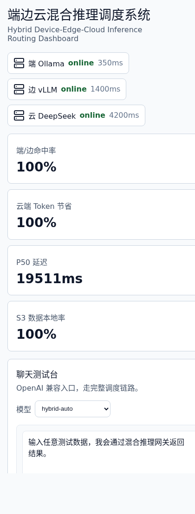

<p align="center">
  <h1 align="center">Hybrid Router</h1>
  <p align="center">端边云混合推理调度系统 · Device-Edge-Cloud Hybrid Inference Routing Gateway</p>
  <p align="center">A privacy-first, OpenAI-compatible LLM routing gateway that intelligently dispatches requests across device, edge, and cloud tiers.</p>
</p>

<p align="center">
  <a href="LICENSE"></a>
  
  
  
  
</p>

<p align="center">
  <a href="README_EN.md">English</a> · <b>中文</b>
</p>

---

这是一个 OpenAI-compatible 的端、边、云混合推理调度网关。系统不会把用户请求直接发给某个固定模型，而是先经过任务复杂度分类、隐私分级、本地能力识别、上下文长度估算、缓存判断和运行状态评估，再决定请求应该走端侧、边侧还是云侧。

项目包含 Gateway、可视化 Dashboard、Redis 缓存与轨迹、Prometheus/Grafana 监控、Open WebUI 聊天入口和 Docker Compose 部署配置。



## 为什么选择 Hybrid Router

| 特性 | Hybrid Router | 传统 LLM 代理 | 纯云 API |
| --- | --- | --- | --- |
| 隐私分级路由（S1/S2/S3） | ✅ 三级隐私策略，S1 数据禁止出端 | ❌ | ❌ |
| 自动数据脱敏 | ✅ PII 检测 + 占位符替换 | ❌ | ❌ |
| 端-边-云三层调度 | ✅ 设备/边缘/云端自动决策 | ❌ 仅云端转发 | ❌ 单层 |
| 两级复杂度分类 | ✅ semantic-router + RouteLLM，无需 LLM-as-Judge | ❌ | ❌ |
| 本地能力感知 | ✅ 本地文件/本地动作自动留在端侧 | ❌ | ❌ |
| 成本优化 | ✅ 68%+ 请求本地处理，云端 Token 成本降低 70% | 部分 | ❌ |
| OpenAI 兼容 | ✅ 直接替换 | ✅ | ✅ |
| 可观测性 | ✅ 路由轨迹 + Prometheus + Grafana | 部分 | ❌ |
| 零 GPU 演示 | ✅ Mock 模式无需 GPU 或 API Key | ❌ | ❌ |

## 核心能力

- 兼容 OpenAI `/v1/chat/completions` 和 `/v1/models` 接口。
- 新增 `POST /v1/route-preview`：完整执行分类、隐私、Token 与路由判定，但不调用任何模型 API，只返回 device/edge/cloud 决策（见 `docs/ROUTE_PREVIEW.md`）。
- 两级复杂度分类：优先使用本地 `semantic-router`（<5ms），置信度不足时使用 RouteLLM MF 兜底（~20ms）。
- 隐私策略先于模型路由：S1 禁止上云，S2 可脱敏后上云，S3 按能力与成本调度。
- 本地能力策略：本地文件、本地动作请求默认不出云。
- 端侧（Ollama）、边侧（vLLM）、云侧（DeepSeek API）三层逻辑模型，可配置真实 OpenAI-compatible 后端。
- 支持共享真实后端，方便演示时统一使用一个大模型接口，同时保留端/边/云路由展示。
- Redis 语义缓存和路由轨迹记录。
- Dashboard 支持聊天测试、路由分布、KPI、路由轨迹和 Demo Case。
- Prometheus + Grafana 可观测性。
- 可接入 Open WebUI，作为标准聊天界面。

## 架构流程

```text
用户 / Dashboard / Open WebUI
  -> Gateway /v1/chat/completions
  -> API Key 鉴权
  -> 分类缓存
  -> semantic-router 本地向量路由 (<5ms)
  -> RouteLLM MF 兜底分类 (~20ms)
  -> 隐私检测与脱敏 (S1/S2/S3)
  -> 本地文件/本地动作策略
  -> device / edge / cloud 路由决策
  -> 语义缓存
  -> OpenAI-compatible 模型后端 (Ollama / vLLM / DeepSeek)
  -> 路由轨迹 + Prometheus 指标
```

## 截图

### 桌面端 Dashboard


### 移动端布局



## 快速启动

```bash
cp .env.example .env
./start.sh
```

启动后访问：

- Dashboard：`http://localhost:8080`
- Gateway：`http://localhost:4000`
- Grafana：`http://localhost:3001`
- Prometheus：`http://localhost:9090`
- Open WebUI：`http://localhost:3000`

首次体验建议保留 `.env` 中的：

```env
MODEL_BACKEND_MODE=mock
```

这样只 mock 最后的模型生成文本，分类、隐私、路由、缓存、轨迹和 Dashboard 都会真实执行，适合无 API Key、无 GPU 环境先跑通系统。

## 接入真实模型

系统支持两种真实模型接入方式。

### 方式一：演示用共享真实后端

适合演示"路由是否正确"。端、边、云三层逻辑仍然存在，但实际生成统一调用一个 OpenAI-compatible 模型接口。

```env
MODEL_BACKEND_MODE=real
REAL_BACKEND_BASE_URL=https://api.deepseek.com
REAL_BACKEND_API_KEY=your-api-key
REAL_BACKEND_MODEL=deepseek-v4-pro
DEVICE_BACKEND_MODEL=deepseek-v4-pro
EDGE_BACKEND_MODEL=deepseek-v4-pro
CLOUD_BACKEND_MODEL=deepseek-v4-pro
```

### 方式二：端、边、云分别接入

适合真实部署。

```env
MODEL_BACKEND_MODE=real

DEVICE_OPENAI_BASE_URL=http://ollama:11434/v1
DEVICE_BACKEND_MODEL=qwen3:1.5b

EDGE_OPENAI_BASE_URL=http://vllm:8000/v1
EDGE_BACKEND_MODEL=deepseek-ai/DeepSeek-V4-Flash

DEEPSEEK_API_BASE=https://api.deepseek.com/v1
DEEPSEEK_API_KEY=your-api-key
DEEPSEEK_CLOUD_MODEL=deepseek-v4-pro
```

## 路由策略

路由器综合以下信号做决策：

- 任务复杂度：`SIMPLE`、`MEDIUM`、`COMPLEX`、`RESEARCH`、`REASONING`。
- 隐私等级：`S1`、`S2`、`S3`。
- 上下文长度和阈值。
- 边侧是否可用、边侧队列深度。
- 端侧模型能力。
- 本地文件、本地动作等能力边界。
- 缓存命中情况。

默认策略：

| 输入类型 | 默认路由 |
| --- | --- |
| 简单改写、短问答 | 端侧 |
| 复杂分析、结构化处理 | 边侧 |
| 研究型任务、长上下文 | 边侧或云侧 |
| 公开数据的强推理任务 | 云侧 |
| S1 高敏数据 | 端侧或边侧，禁止上云 |
| S2 中敏数据 | 如需上云，先脱敏 |
| 本地文件检索 | 端侧，禁止上云 |
| 本地文件总结且端侧模型不足 | 边侧，禁止上云 |
| 打开浏览器、启动应用等本地动作 | 端侧 |

## 隐私模型

隐私检测在路由之前执行：

- `S1`：高敏数据，禁止上云。
- `S2`：中敏数据，可脱敏后上云。
- `S3`：公开或低风险数据，可按复杂度、成本和能力调度。

检测内容包括手机号、邮箱、身份证号、银行卡、IP、工资、财务、合同、专利、涉密关键词等。S2 数据会替换成占位符，例如 `【PHONE-0001】`、`【ID-0001】`、`【AMOUNT-0001】`。

## 技术栈

| 层级 | 技术 |
| --- | --- |
| 网关 | Python 3.11+, FastAPI, LiteLLM |
| 分类器 | semantic-router, RouteLLM (ICLR 2025) |
| 端侧 | Ollama (Qwen3 1.5B–7B) |
| 边侧 | vLLM (DeepSeek-V4-Flash) |
| 云侧 | DeepSeek API (V4-Pro, 1M context) |
| 缓存 | Redis 7.2 (语义缓存 + 轨迹) |
| 前端 | React 18, TypeScript, Vite 5 |
| 监控 | Prometheus 2.50+, Grafana 10.4+ |
| 部署 | Docker Compose, ARM64 兼容 |

## 目录结构

```text
gateway/              OpenAI-compatible 混合路由网关
dashboard/            Dashboard 后端和 React 前端
monitoring/           Prometheus 和 Grafana 配置
scripts/              Demo 和压测脚本
tests/                分类、隐私、路由、Demo Case 测试
ollama/               端侧模型辅助文件
vllm/                 边侧模型辅助文件
docs/                 PRD、技术报告、截图
docker-compose.yml    本地完整部署
```

## 本地开发

安装依赖并运行测试：

```bash
python3 -m pip install -r gateway/requirements.txt -r dashboard/requirements.txt pytest
pytest tests/ -v
```

构建前端：

```bash
cd dashboard/frontend
npm install
npm run build
```

## 国内网络说明

首次启动 Gateway 会下载分类器相关模型和权重。`.env.example` 默认配置了：

- `USE_MODELSCOPE=true`
- `HF_ENDPOINT=https://hf-mirror.com`
- `PIP_INDEX_URL` 使用国内镜像

如果在海外环境使用，也可以把这些镜像配置改回官方源。

## GitHub Topics 建议

推送到 GitHub 后，建议在仓库 Settings → Topics 中添加以下标签，提升搜索曝光：

```
llm  llm-router  ai-gateway  edge-computing  privacy  openai-compatible
inference-router  device-edge-cloud  semantic-cache  ollama  vllm  deepseek
hybrid-inference  cost-optimization  fastapi  docker-compose
```

## 开源注意事项

- 不要提交真实 `.env`。
- 不要提交 API Key、Token、数据库密码。
- 不要提交 `.venv`、`node_modules`、模型缓存、运行轨迹、Docker volume。
- 公开演示建议使用 `MODEL_BACKEND_MODE=mock`。
- 真实后端密钥建议通过私有部署环境变量或 GitHub Secrets 管理。

## 文档

- [技术报告](docs/TECHNICAL_REPORT.md)
- [产品需求文档](docs/PRD_端边云混合推理调度系统.md)

## License

[Apache License 2.0](LICENSE)
