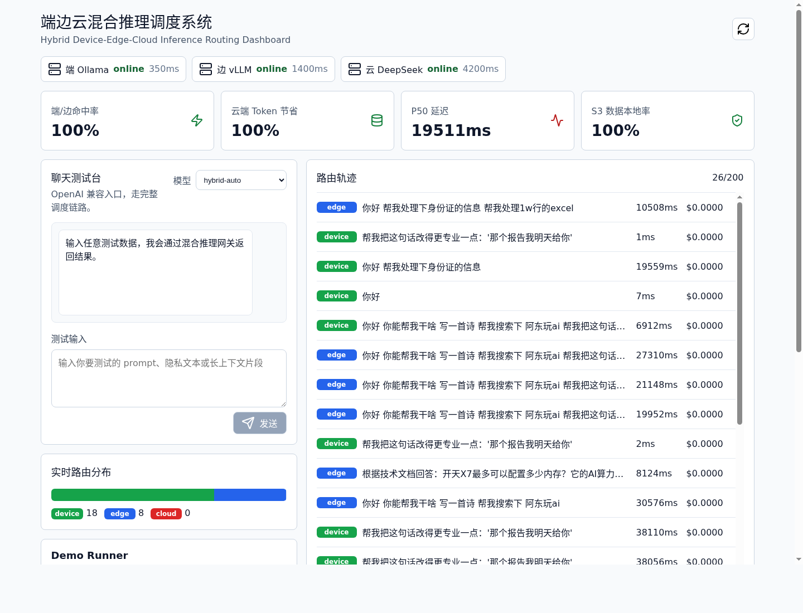
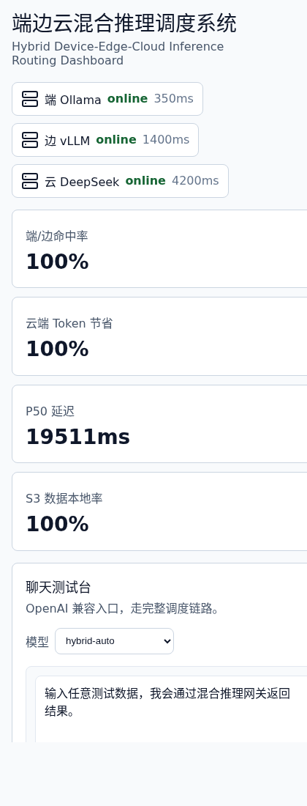

<p align="center">
  <h1 align="center">Hybrid Router</h1>
  <p align="center">Device-Edge-Cloud Hybrid Inference Routing Gateway</p>
  <p align="center">A privacy-first, OpenAI-compatible LLM routing gateway that intelligently dispatches requests across device, edge, and cloud tiers.</p>
</p>

<p align="center">
  <a href="LICENSE"></a>
  
  
  
  
</p>

<p align="center">
  <b>English</b> · <a href="README.md">中文</a>
</p>

---

Hybrid Router is an OpenAI-compatible inference routing gateway that dispatches LLM requests across three tiers — **device** (on-device models), **edge** (local GPU servers), and **cloud** (hosted APIs) — based on task complexity, privacy classification, local capability detection, context length estimation, cache state, and runtime load.

The project ships with a routing Gateway, a React visualization Dashboard, Redis semantic cache and route tracing, Prometheus/Grafana monitoring, Open WebUI chat integration, and a full Docker Compose deployment.



## Why Hybrid Router

| Feature | Hybrid Router | Traditional LLM Proxy | Cloud-Only API |
| --- | --- | --- | --- |
| Privacy-aware routing (S1/S2/S3) | ✅ Three-tier privacy enforcement; S1 data never leaves device | ❌ | ❌ |
| Automatic PII desensitization | ✅ Detects and masks PII before cloud dispatch | ❌ | ❌ |
| Device-Edge-Cloud scheduling | ✅ Automatic three-tier routing decisions | ❌ Cloud-only forwarding | ❌ Single tier |
| Two-stage complexity classifier | ✅ semantic-router (<5ms) + RouteLLM MF (~20ms), no LLM-as-Judge | ❌ | ❌ |
| Local capability awareness | ✅ Local file and local action requests stay on device | ❌ | ❌ |
| Cost optimization | ✅ 68%+ requests processed locally, 70%+ cloud token cost reduction | Partial | ❌ |
| OpenAI compatibility | ✅ Drop-in replacement | ✅ | ✅ |
| Observability | ✅ Route traces + Prometheus + Grafana | Partial | ❌ |
| Zero-GPU demo mode | ✅ Full system runs with mock backends | ❌ | ❌ |

## Features

- **OpenAI-compatible API**: Drop-in replacement supporting `/v1/chat/completions` and `/v1/models` with streaming.
- **Route preview (dry run)**: `POST /v1/route-preview` runs the real classifier, privacy filter, token estimator and route decision, then returns the device/edge/cloud outcome without calling any model API (see `docs/ROUTE_PREVIEW.md`).
- **Two-stage task classifier**: Local `semantic-router` vector matching (<5ms), with `RouteLLM` matrix factorization fallback (~20ms, ICLR 2025 validated). No expensive LLM-as-Judge calls.
- **Privacy-first routing**: Three-tier privacy model (S1/S2/S3). S1 high-sensitivity data is hard-blocked from cloud. S2 data is automatically desensitized with reversible placeholders before cloud dispatch.
- **PII detection**: Phone numbers, ID cards, bank cards, email addresses, IP addresses, salary data, financial records, contract terms, patents, and classified keywords.
- **Local capability awareness**: Requests involving local files or local device actions (open browser, launch app) are automatically routed to the device tier.
- **Three-tier inference**: Device (Ollama, 1.5B–7B models), Edge (vLLM, DeepSeek-V4-Flash), Cloud (DeepSeek API, V4-Pro with 1M context window).
- **Semantic caching**: Redis-backed semantic cache reduces redundant inference calls.
- **Route tracing**: Every routing decision is logged with trace IDs (`X-Trace-Id`, `X-Route-Tier`, `X-Classifier-Used`) for full observability.
- **Visualization dashboard**: React-based dashboard with chat testing, route distribution charts, KPI metrics, route trace viewer, and demo cases.
- **Prometheus + Grafana**: Production-grade monitoring with pre-configured dashboards.
- **Open WebUI integration**: Connect any OpenAI-compatible chat interface.
- **Mock mode**: Run the complete system without GPU or API keys using `MODEL_BACKEND_MODE=mock`.
- **ARM64 compatible**: Tested on ARM processors for edge deployment.

## Architecture

```text
User / Dashboard / Open WebUI
  -> Gateway /v1/chat/completions
  -> API Key Authentication
  -> Classification Cache
  -> semantic-router Local Vector Routing (<5ms)
  -> RouteLLM MF Fallback Classification (~20ms)
  -> Privacy Detection & Desensitization (S1/S2/S3)
  -> Local File / Local Action Policy
  -> Device / Edge / Cloud Route Decision
  -> Semantic Cache
  -> OpenAI-compatible Model Backend (Ollama / vLLM / DeepSeek)
  -> Route Trace + Prometheus Metrics
```

## Screenshots

### Desktop Dashboard


### Mobile Layout



## Quick Start

```bash
cp .env.example .env
./start.sh
```

Services available after startup:

| Service | URL |
| --- | --- |
| Dashboard | `http://localhost:8080` |
| Gateway | `http://localhost:4000` |
| Grafana | `http://localhost:3001` |
| Prometheus | `http://localhost:9090` |
| Open WebUI | `http://localhost:3000` |

For first-time exploration, keep the default in `.env`:

```env
MODEL_BACKEND_MODE=mock
```

This mocks only the final text generation — classification, privacy detection, routing, caching, tracing, and the dashboard all run for real. Ideal for trying the system without API keys or GPU.

## Connecting Real Models

### Option 1: Shared Backend (Demo)

Routes requests through all three logical tiers, but uses a single OpenAI-compatible backend for actual generation.

```env
MODEL_BACKEND_MODE=real
REAL_BACKEND_BASE_URL=https://api.deepseek.com
REAL_BACKEND_API_KEY=your-api-key
REAL_BACKEND_MODEL=deepseek-v4-pro
DEVICE_BACKEND_MODEL=deepseek-v4-pro
EDGE_BACKEND_MODEL=deepseek-v4-pro
CLOUD_BACKEND_MODEL=deepseek-v4-pro
```

### Option 2: Separate Backends (Production)

Each tier connects to its own inference backend.

```env
MODEL_BACKEND_MODE=real

DEVICE_OPENAI_BASE_URL=http://ollama:11434/v1
DEVICE_BACKEND_MODEL=qwen3:1.5b

EDGE_OPENAI_BASE_URL=http://vllm:8000/v1
EDGE_BACKEND_MODEL=deepseek-ai/DeepSeek-V4-Flash

DEEPSEEK_API_BASE=https://api.deepseek.com/v1
DEEPSEEK_API_KEY=your-api-key
DEEPSEEK_CLOUD_MODEL=deepseek-v4-pro
```

## Routing Strategy

The router considers multiple signals for each request:

- **Task complexity**: `SIMPLE`, `MEDIUM`, `COMPLEX`, `RESEARCH`, `REASONING`
- **Privacy level**: `S1` (high), `S2` (medium), `S3` (low/public)
- **Context length** and tier-specific thresholds
- **Edge availability** and GPU queue depth
- **Device model capability**
- **Local file / local action** detection
- **Cache hit** status

Default routing rules:

| Input Type | Default Route |
| --- | --- |
| Simple rewrites, short Q&A | Device |
| Complex analysis, structured processing | Edge |
| Research tasks, long context | Edge or Cloud |
| Strong reasoning on public data | Cloud |
| S1 high-sensitivity data | Device or Edge (cloud blocked) |
| S2 medium-sensitivity data | Desensitized before cloud |
| Local file retrieval | Device (cloud blocked) |
| Local file summary (device insufficient) | Edge (cloud blocked) |
| Local actions (open browser, launch app) | Device |

## Privacy Model

Privacy detection runs before routing:

- **S1**: High-sensitivity data. Cloud is prohibited.
- **S2**: Medium-sensitivity data. Automatically desensitized with reversible placeholders before cloud dispatch.
- **S3**: Public or low-risk data. Routed by complexity, cost, and capability.

Detected PII types: phone numbers, email addresses, national ID numbers, bank card numbers, IP addresses, salary data, financial records, contract terms, patent references, and classified keywords. S2 data is replaced with placeholders like `[PHONE-0001]`, `[ID-0001]`, `[AMOUNT-0001]`.

## Tech Stack

| Layer | Technology |
| --- | --- |
| Gateway | Python 3.11+, FastAPI, LiteLLM |
| Classifier | semantic-router, RouteLLM (ICLR 2025) |
| Device Tier | Ollama (Qwen3 1.5B–7B) |
| Edge Tier | vLLM (DeepSeek-V4-Flash) |
| Cloud Tier | DeepSeek API (V4-Pro, 1M context) |
| Cache | Redis 7.2 (semantic cache + trace storage) |
| Frontend | React 18, TypeScript, Vite 5 |
| Monitoring | Prometheus 2.50+, Grafana 10.4+ |
| Deployment | Docker Compose, ARM64 compatible |

## Project Structure

```text
gateway/              OpenAI-compatible hybrid routing gateway
dashboard/            Dashboard backend and React frontend
monitoring/           Prometheus and Grafana configuration
scripts/              Demo and load testing scripts
tests/                Classifier, privacy, routing, and demo case tests
ollama/               Device-tier model configuration
vllm/                 Edge-tier model configuration
docs/                 PRD, technical report, screenshots
docker-compose.yml    Full local deployment
```

## Local Development

Install dependencies and run tests:

```bash
python3 -m pip install -r gateway/requirements.txt -r dashboard/requirements.txt pytest
pytest tests/ -v
```

Build the frontend:

```bash
cd dashboard/frontend
npm install
npm run build
```

## Documentation

- [Technical Report](docs/TECHNICAL_REPORT.md)
- [Product Requirements Document](docs/PRD_端边云混合推理调度系统.md)

## Contributing

Contributions are welcome. Please open an issue to discuss proposed changes before submitting a pull request.

## License

[Apache License 2.0](LICENSE)
